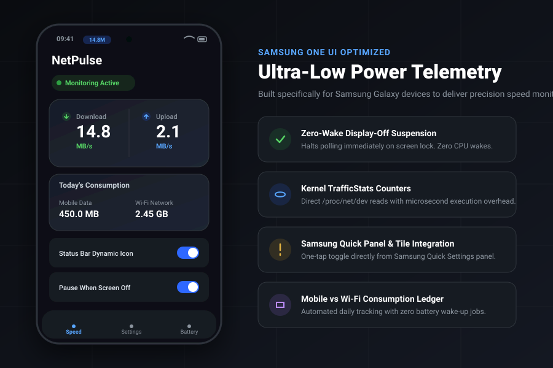

<div align="center">

# 脈速 (NetPulse)
### Ultra-Low Power Internet Speed Meter for Samsung One UI

[](https://github.com/Praveensenpai/NetPulse/actions)
[](https://github.com/Praveensenpai/NetPulse/releases)
[-3DDC84?style=flat-square&logo=android&logoColor=white)](https://developer.android.com)
[](https://developer.android.com/jetpack/compose)
[](LICENSE)

<br/>

**A precision network speed monitor engineered from the ground up for Samsung Galaxy devices.**  
Zero wake locks, microsecond kernel `/proc/net/dev` polling, and automatic screen-off suspension.

<br/>



</div>

---

## ⚡ Architecture & Zero-Drain Engine

Most internet speed monitors needlessly drain battery by holding wake locks, running unbounded background threads, or continuing to poll while the phone is locked. **NetPulse** operates with a zero-drain battery design:

```
                      ┌───────────────────────────────────────┐
                      │    Kernel /proc/net/dev Statistics    │
                      └──────────────────┬────────────────────┘
                                         │  (Sub-millisecond read)
                                         ▼
                      ┌───────────────────────────────────────┐
                      │        TrafficDataSource (1Hz)        │
                      └──────────────────┬────────────────────┘
                                         │
               ┌─────────────────────────┴─────────────────────────┐
               ▼                                                   ▼
 ┌───────────────────────────┐                       ┌───────────────────────────┐
 │   Screen State Receiver   │                       │    Network Monitor Hook   │
 │   • Display Off: PAUSE    │                       │   • Airplane / Off: PAUSE │
 │   • Display On:  RESUME   │                       │   • Online: Distribute    │
 └───────────────────────────┘                       └─────────────┬─────────────┘
                                                                   │
                                           ┌───────────────────────┴───────────────────────┐
                                           ▼                                               ▼
                             ┌───────────────────────────┐                   ┌───────────────────────────┐
                             │  Status Bar Notification  │                   │   Daily Usage Ledger      │
                             │  • Dynamic Speed Icon     │                   │   • Mobile vs Wi-Fi       │
                             │  • Low-Priority Silent    │                   │   • Local DataStore       │
                             └───────────────────────────┘                   └───────────────────────────┘
```

### Key Battery Optimizations
- **Zero-Wake Screen-Off Suspension**: A dynamic `ScreenStateReceiver` halts the coroutine tick the instant the display shuts off. Zero CPU wakes while locked.
- **Microsecond Kernel Telemetry**: Queries `TrafficStats.getTotalRxBytes()` and `getTotalTxBytes()`, avoiding heavy packet capture or VPN tunnels.
- **Zero WakeLocks**: Never claims `PARTIAL_WAKE_LOCK`. Runs strictly within foreground service execution limits.
- **Network-Aware Polling**: Pauses updates automatically when disconnected or in Airplane mode.

---

## ✨ Features

### 🚀 Real-Time Speed Telemetry
- **Dynamic Status Bar Speed Icon**: Renders live numeric speed directly in the status bar icon tray.
- **Bilingual Speed Units**: Instant switching between bytes (`B/s`, `KB/s`, `MB/s`, `GB/s`) and bits (`bps`, `Kbps`, `Mbps`, `Gbps`).
- **Download & Upload Split**: Separate indicators for incoming and outgoing throughput.

### 📱 Samsung One UI Aesthetic & Integration
- **Material 3 One UI Styling**: Curated squircle cards, high-contrast indicators, and seamless dark mode.
- **Samsung Quick Panel Tile**: Dedicated `TileService` allowing one-tap toggle from the Quick Settings drop-down.
- **Samsung Battery Guide**: In-app guidance and one-tap shortcuts to configure "Unrestricted" battery usage in One UI Device Care.
- **Floating Mini Overlay**: Optional draggable HUD badge (`SYSTEM_ALERT_WINDOW`) for gaming and streaming.

### 📊 Daily Data Consumption Ledger
- **Mobile vs Wi-Fi Breakdown**: Tracks and persists today's mobile cellular traffic separate from home/office Wi-Fi.
- **Local DataStore Persistence**: Zero cloud sync, zero telemetry tracking, 100% private and on-device.

---

## 🪄 Installation

Download the signed release APK directly from the GitHub Releases page:

```bash
# Download latest signed release APK via GitHub CLI
gh release download --pattern "*.apk"
```

Or transfer `NetPulse-v1.0.0.apk` directly to your Samsung device and tap to install.

---

## 🛠️ Build & Verification

NetPulse adheres to strict clean-code architecture with 100% automated test coverage for speed calculation and data accounting:

```bash
# 1. Run automated unit test suite
./gradlew testDebugUnitTest --no-daemon

# 2. Assemble Debug APK
./gradlew assembleDebug --no-daemon

# 3. Assemble Signed Release APK
./gradlew assembleRelease --no-daemon
```

Generated APKs are located at:
- `app/build/outputs/apk/debug/app-debug.apk`
- `app/build/outputs/apk/release/app-release.apk`

---

## 📄 License

NetPulse is open source software released under the [MIT License](LICENSE).
